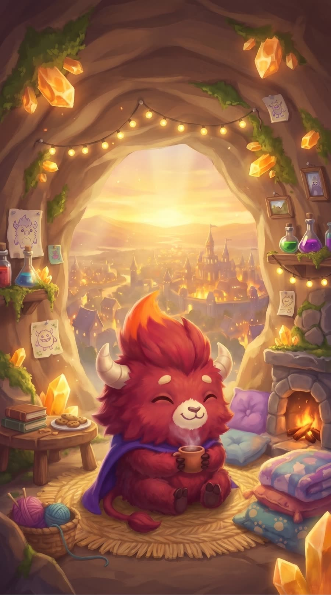

# Portfolio

AI animation & design portfolio by Eric Gimarse — building app & game UI in public.

## What this is

This site solves a simple problem: clients and collaborators can see my AI animation and design work in one place, live on the web, instead of scattered across apps and chats.

## About me

- AI animator & designer based in the Inland Empire, Southern California
- Tools: Google Flow, Higgsfield, and ElevenLabs (Creator plan)
- Currently learning to code by building real projects, starting with HTML, CSS, and a little JavaScript
- Interests: mobile apps, games, and animated / interactive UI

## Portfolio pieces

1. **Piece #1: Flair Poof — animated game title screen.** An original character (a fluffy red poof monster whose tuft is a living flame) on a cliff above a glowing kingdom. I designed the character, built a front / side / back turnaround sheet for consistency, generated the sunset cliff scene, animated it into a seamless loop, and built the interactive title screen page: full-screen video background, game menu with keyboard navigation, a face-reveal moment on "New Game," and a working motion setting.
   - Play it live: https://obiandrobi.github.io/Portfolio/flair-poof.html
   - 
2. **Piece #2: Poof — animated app home screen.** A cozy daily-quest companion app starring the same character: Poof lives in a cave in the hills, too shy to visit the glowing town below, and the tiny quests you finish together grow the living flame on his head (the streak counter). I designed and animated his cave home overlooking the town, then built the interactive home screen: tappable quest cards, an animated progress ring, ember rewards, a growing streak flame, a celebration when all quests are done, and four working tabs — all presented in a phone mockup.
   - Try it live: https://obiandrobi.github.io/Portfolio/poof.html
   - 
3. Piece #3: To be announced

## Live site

https://obiandrobi.github.io/Portfolio/

## Follow the build

I am learning in public. Each project in this repo will include what I made, how I made it, and what I learned.
